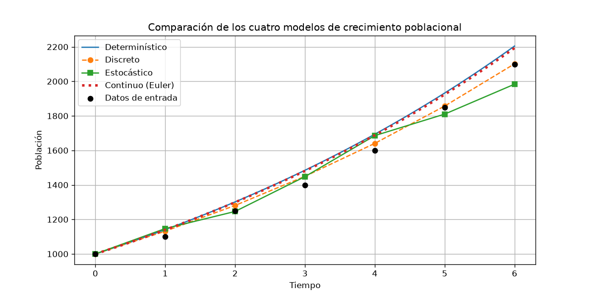
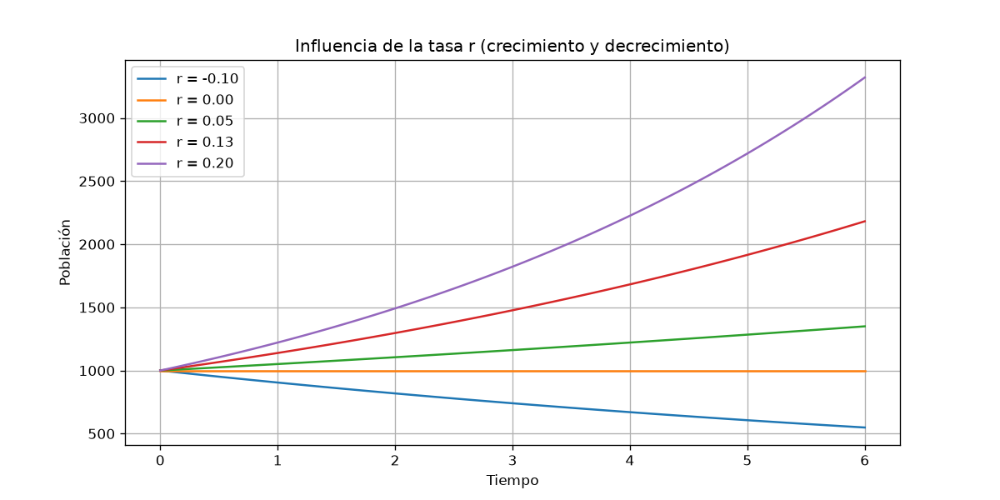
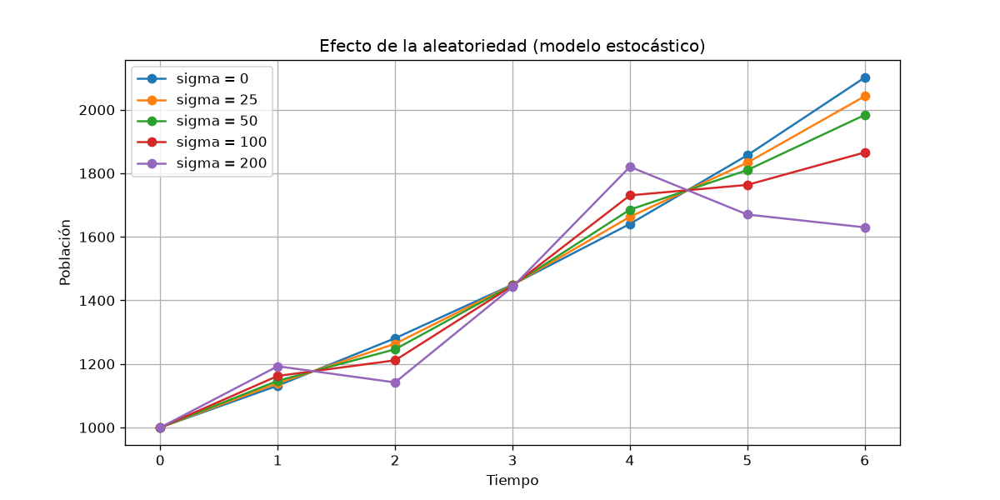

# Práctica 02 - Comparación de modelos determinísticos, estocásticos, discretos y continuos

**Asignatura:** Simulación
**Ciclo:** Ciclo 5
**Carrera:** Carrera de Computación - UNL
**Docente:** José O. Guamán Q.
**Estudiante:** Cael Alejandro Soto Castillo.

## 1. Descripción del proyecto

Simula el **crecimiento poblacional** con cuatro modelos y los compara sobre los mismos datos
de entrada (`[1000, 1100, 1250, 1400, 1600, 1850, 2100]`).

**Propósito:** diferenciar los paradigmas de simulación. El proyecto responde a tres preguntas:

- ¿En qué se diferencia un modelo determinístico de uno estocástico?
- ¿En qué se diferencia un modelo discreto de uno continuo?
- ¿Cómo afectan la tasa `r` y la aleatoriedad `sigma` a los resultados?

| Modelo | Ecuación | Característica |
|---|---|---|
| Determinístico | `P(t) = P0·e^(r·t)` | Sin aleatoriedad |
| Discreto | `P(t+1) = P(t) + r·P(t)` | Cambia por períodos |
| Estocástico | `P(t+1) = P(t) + r·P(t) + ε`, `ε ~ N(0, σ²)` | Incluye ruido aleatorio |
| Continuo (Euler) | `P(t+dt) = P(t) + dt·r·P(t)` | Aproxima `dP/dt = r·P` con pasos pequeños |

Los parámetros salen del arreglo de entrada: `P0` es el primer dato, `tiempo` es el número de
períodos (6) y `r` es el promedio de la tasa de crecimiento entre períodos consecutivos (≈ 0.1318).

## 2. Tecnologías utilizadas

- Python 3
- NumPy (cálculo y números aleatorios)
- Matplotlib (gráficas)
- Arquitectura Modelo-Vista-Controlador y patrón Strategy (los cuatro modelos comparten el
  método `simular`)

## 3. Instalación

En Ubuntu:

```bash
sudo apt update
sudo apt install python3 python3-venv python3-pip    # solo la primera vez
cd simulacion_poblacion
python3 -m venv venv
source venv/bin/activate
pip install -r requirements.txt
```

## 4. Uso

```bash
python3 main.py
```

Se imprimen en la terminal los parámetros y la población final de cada modelo, y luego se
abren tres gráficas (cerrar cada ventana para ver la siguiente). También se guardan en
`graficas/`.

## 5. Configuración

Los parámetros se cambian en dos lugares:

- `modelo/parametros.py`: `DATOS` (arreglo de entrada) y los valores por defecto de `sigma`
  (ruido), `dt` (paso de Euler) y `semilla` (para repetir los mismos números aleatorios).
- `controlador/controlador.py`: `VALORES_R` y `VALORES_SIGMA`, que son los valores que se
  prueban en las gráficas de influencia.

Si se cambia `DATOS`, `P0`, `tiempo` y `r` se recalculan solos.

## 6. Estructura del proyecto

```
simulacion_poblacion/
├── main.py                    # punto de entrada
├── requirements.txt           # librerías necesarias
├── .gitignore
├── modelo/
│   ├── parametros.py          # datos de entrada y cálculo de P0, r, tiempo
│   └── modelos.py             # los cuatro modelos (clase Modelo + una clase por modelo)
├── vista/
│   ├── vista_consola.py       # parámetros y tabla de resultados por consola
│   └── vista_grafica.py       # las tres gráficas
├── controlador/
│   └── controlador.py         # ejecuta los modelos y llama a las vistas
└── graficas/                  # imágenes generadas al ejecutar
```

## 7. Información adicional

### Funcionalidades

- Los cuatro modelos con los mismos parámetros y una gráfica comparativa.
- Gráfica de la influencia de `r` (incluye una tasa negativa para ver el decrecimiento).
- Gráfica del efecto de `sigma` en el modelo estocástico.

### Resultados

Población final (período 6) con `r ≈ 0.1318`, `sigma = 50`, `dt = 0.1`. El dato real es 2100.

| Modelo | P final | Diferencia con el dato real |
|---|---:|---:|
| Determinístico | 2204.7 | +104.7 |
| Discreto | 2101.6 | +1.6 |
| Estocástico | 1983.7 | -116.3 |
| Continuo (Euler) | 2193.4 | +93.4 |





### Interpretación matemática

- **Determinístico vs continuo:** el modelo continuo con Euler aproxima la misma curva
  exponencial. LOs resultados dan 2204.7 y 2193.4 porque Euler con `dt = 0.1` comete un error pequeño. Si
  `dt` se hace más pequeño, el resultado se acerca al exacto.
- **Discreto:** el modelo discreto es Euler con `dt = 1` (con ese paso ambos dan 2101.6). Como
  el crecimiento se aplica una sola vez por período y no de forma continua, da menos que el
  exponencial (`(1 + r)^t` es menor que `e^(r·t)`).
- **Influencia de r:** `r` está en el exponente así que el efecto crece con el tiempo. Con
  `P0 = 1000` y 6 períodos: `r = -0.10` baja a 548.8 (decrecimiento), `r = 0` se queda en
  1000, `r = 0.05` llega a 1349.9, `r = 0.13` a 2181.5 y `r = 0.20` a 3320.1.
  `r > 0` crece, `r = 0` es constante y `r < 0` decrece.
- **Aleatoriedad:** con `sigma = 0` el estocástico es igual al discreto (2102 al final con
  esta semilla, por el redondeo el discreto da 2101.6). Al subir `sigma` la trayectoria se
  aleja de la determinística: con `sigma = 200` termina en 1630. El ruido es aditivo, así que
  cada error se arrastra a los períodos siguientes. Si se cambia la semilla, la trayectoria
  cambia, mientras que los modelos determinísticos siempre dan lo mismo.
- **Efecto del ruido en la media:** una sola ejecución estocástica no es representativa, solo
  muestra una de las trayectorias posibles.

### Bibliografía

Diapositivas semana 2.

### Uso de IA

**Prompt que usamos:**

> Estoy haciendo la siguiente práctica (adjunto la guía y una imagen con la estructura
> de un README). Necesito resolverla solo en Python, con arquitectura Modelo-Vista-Controlador
> y un patrón de diseño simple, siguiendo el pseudocódigo de la guía y sin complicar el
> código. Elabora el README según la imagen, el .gitignore y el requirements.txt, y explícame
> el proyecto para poder defenderlo y realizarlo por mi cuenta.

**Dónde se usó IA:**

- Pautas para entender la práctica y los cuatro modelos.
- Estructura de carpetas (modelo, vista, controlador) y elección del patrón Strategy.
- Código de `vista_grafica.py` y correcciones de código generales a partir del pseudocódigo de la guía.
- Redacción del README (formato y estructura), `.gitignore` y `requirements.txt`.
