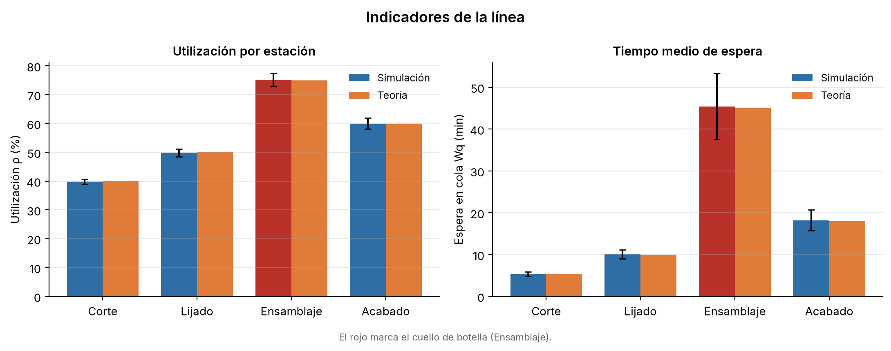
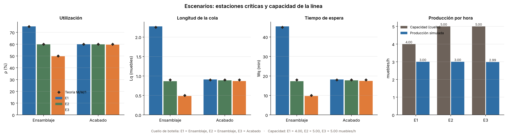

# Simulación de una línea de producción de muebles

Proyecto grupal: simulación de eventos discretos de una línea de fabricación de muebles (corte → lijado → ensamblaje → acabado), con modelo matemático, programa en Python, experimentos y un informe académico en formato IEEE.

**Tema:** identificación de cuellos de botella en una línea de producción de muebles de madera
mediante simulación de eventos discretos en Python.

**Grupo 10:** Victor Roa, Francis Valdiviezo, Cael Soto, Jimmy Ontaneda y Alejandro Padilla.

El modelo teórico es **M/M/1** (un operario por estación) y se ejecutan tres escenarios: **E1** (base, ensamblaje en 15 min), **E2** (ensamblaje en 12 min) y **E3** (ensamblaje en 10 min).

**Tecnologías:** Python 3.12+, SimPy 4.1, NumPy 2.5, pandas 3.0, Matplotlib 3.11 y pytest 9.1,
con organización MVC (modelo, vista y controlador).

---

## Inicio rápido

Requiere **Python 3.12 o superior**: `requirements.txt` fija NumPy 2.5.4, que no existe para
Python 3.10 ni 3.11. Con una versión anterior, `pip install` falla con:

```text
ERROR: Could not find a version that satisfies the requirement numpy==2.5.4
ERROR: No matching distribution found for numpy==2.5.4
```

La solución es instalar Python 3.12+ (en [python.org](https://www.python.org/downloads/)
o con el gestor de tu sistema) y crear el entorno con ese intérprete, como se ve abajo.
Comprobá tu versión con `python --version` (en Windows, `py --list` muestra las instaladas).

Todos los comandos se ejecutan desde la raíz del repositorio (la carpeta que contiene
`03-simulacion/`).

**Windows (PowerShell):**

```powershell
py -3.12 -m venv .venv
.venv\Scripts\activate
python -m pip install -r 03-simulacion/requirements.txt
```

Si PowerShell bloquea la activación, ejecutá una vez
`Set-ExecutionPolicy -Scope Process Bypass`. En CMD, la activación es
`.venv\Scripts\activate.bat`.

**macOS:**

```bash
python3 -m venv .venv
source .venv/bin/activate
python -m pip install -r 03-simulacion/requirements.txt
```

**Linux (Ubuntu 24.04 o superior):** además del intérprete, instalá `venv`, `pip` y, para
abrir el panel o la animación, Tk:

```bash
sudo apt update
sudo apt install -y python3 python3-venv python3-pip python3-tk
python3 -m venv .venv
source .venv/bin/activate
python -m pip install -r 03-simulacion/requirements.txt
```

Si tu Ubuntu trae una versión anterior de Python, instalá Python 3.12+ y su módulo `venv`,
y creá el entorno con ese intérprete (por ejemplo, `python3.12 -m venv .venv`).

Con el entorno activo (el prompt muestra `(.venv)`), entrá a `03-simulacion` y ejecutá:

```bash
cd 03-simulacion
python main.py     # simula la línea base y escribe CSV y gráficos en salidas/
python panel.py    # abre la pantalla única: parámetros, taller animado y resultados
python -m pytest   # corre las pruebas
```

### Si algo falla

| Problema | Causa probable | Solución |
|---|---|---|
| `No matching distribution found for numpy==2.5.4` | Python 3.10 o 3.11 | Instalá Python 3.12+ y recreá el entorno (`py -3.12 -m venv .venv` en Windows) |
| `python` o `py` no se reconoce | Python no está en el PATH | En Windows usá `py -3.12`; en macOS/Linux, `python3` |
| `No module named 'simpy'` (o `matplotlib`, `numpy`) | El entorno virtual no está activado | Activalo otra vez; si no activa, usá `.venv/bin/python` (Windows: `.venv\Scripts\python.exe`) |
| `No module named 'tkinter'` | Falta Tk | Linux: `sudo apt install python3-tk`; en Windows y macOS marcá Tk al instalar Python desde python.org |
| `No module named 'vista'` o `No such file: panel.py` | Estás en otra carpeta | `cd 03-simulacion` |
| `TclError: no display name and no $DISPLAY` | No hay entorno gráfico (SSH, WSL) | Usá `python animacion.py --guardar salidas/graficos/base.gif` |

Las dependencias directas fijadas en `requirements.txt` son:

| Paquete | Versión fijada | Uso |
|---|:---:|---|
| SimPy | 4.1.2 | Simulación de eventos discretos |
| NumPy | 2.5.4 | Números aleatorios |
| pandas | 3.0.6 | Resultados en CSV |
| Matplotlib | 3.11.2 | Gráficos y animación |
| pytest | 9.1.1 | Pruebas automáticas |

Las instrucciones completas, la explicación de cada gráfica y la solución de problemas están
en [`03-simulacion/README.md`](03-simulacion/README.md).

### Cambiar los valores (λ y tiempos)

Hay dos formas, y ninguna obliga a tocar el código Python:

- **Ventana:** `python panel.py` abre una sola pantalla con las casillas de cada valor, el
  taller animado y los resultados, y los botones Animar de nuevo, Pausa, Simular, Guardar y
  Restaurar.
- **Archivo:** editar o copiar `03-simulacion/escenarios/base.json`. La guía de cada campo
  está en [`03-simulacion/escenarios/README.md`](03-simulacion/escenarios/README.md).

Para generar la animación como GIF, sin abrir ventana:

```bash
cd 03-simulacion
python animacion.py --guardar salidas/graficos/base.gif
```

> **Nota:** si el comando `python` falla, casi siempre es porque el entorno virtual no está
> activado. Los comandos de las subsecciones siguientes suponen que estás dentro de
> `03-simulacion/`.

---

## Estado del proyecto

| Parte | Carpeta | Estado |
|---|---|:---:|
| Investigación y marco teórico | [`01-investigacion/`](01-investigacion/) | Lista original de referencias (`referencias.bib`, 8 entradas); la bibliografía final del informe está en [`05-informe/latex/referencias.bib`](05-informe/latex/referencias.bib) |
| Modelo matemático | [`02-modelo/`](02-modelo/) | [`README.md`](02-modelo/README.md) con el modelo matemático: supuestos, parámetros, ecuaciones e indicadores |
| Programación y simulación | [`03-simulacion/`](03-simulacion/) | ✅ Terminado: simulación, panel y animación; **152 pruebas pasan** |
| Experimentos (E1, E2, E3) | [`04-experimentos/`](04-experimentos/) | ✅ Resultados, tablas y gráficas generados |
| Informe final (formato IEEE) | [`05-informe/documento/`](05-informe/documento/) | ✅ [`Informe_Linea_Muebles_IEEE.pdf`](05-informe/documento/Informe_Linea_Muebles_IEEE.pdf) y su DOCX editable |

La coordinación del grupo se hizo fuera de GitHub; este repositorio guarda el código, los
datos y la documentación disponible.

---

## Simulación

Línea de fabricación de muebles con cuatro estaciones en serie, cada una con su cola FIFO
sin límite y `ci` operarios que atienden un mueble a la vez. Llegadas de Poisson con
λ = 3 muebles/h y tiempos de servicio exponenciales con media `ti`.

**Parámetros de la línea base (Tabla III del informe):**

| Estación | ci | ti (min/mueble) |
|---|:---:|:---:|
| Corte | 1 | 8 |
| Lijado | 1 | 10 |
| Ensamblaje | 1 | 15 |
| Acabado | 1 | 12 |

**Configuración de la corrida:** línea vacía al inicio, 30 réplicas independientes con
semillas distintas, 1 000 h por réplica y 100 h de calentamiento descartadas.

**Control:** el promedio de la simulación base se acerca a la Tabla IV del informe
(por ejemplo, ensamblaje con ρ ≈ 75 % y Wq ≈ 45 min). Cada resumen también compara
`Lq` con `λ efectiva · Wq`, usando el throughput observado, para verificar la Ley de Little
(ecuación (6)).

### Escenarios experimentales

`ci` y `ti` se cambian sin tocar el código, con los archivos JSON de `03-simulacion/escenarios/`:

| Escenario | Archivo | Cambio frente a la base |
|---|---|---|
| E1 · Línea base | `base.json` | Ensamblaje en 15 min (referencia) |
| E2 · Ensamblaje en 12 min | `e2.json` | `t3 = 12` min (un operario) |
| E3 · Ensamblaje en 10 min | `e3.json` | `t3 = 10` min en ensamblaje |

Todos los escenarios usan **un operario por estación** (`ci = 1`), por eso la teoría es M/M/1.

Para correr los tres y dejar los resultados en `04-experimentos/`:

```bash
cd 03-simulacion
python main.py --config escenarios/base.json escenarios/e2.json escenarios/e3.json \
  --salida ../04-experimentos
```

### Resultados principales

| Indicador | E1 Base | E2 (t₃ = 12 min) | E3 (t₃ = 10 min) |
|---|:---:|:---:|:---:|
| ρ ensamblaje | 75,1 % | 59,8 % | 49,7 % |
| Lq ensamblaje | 2,27 | 0,86 | 0,48 |
| Wq ensamblaje | 45,4 min | 17,3 min | 9,7 min |
| Tiempo total de flujo | 124,0 min | 92,2 min | 82,2 min |
| Producción | 2,998 muebles/h | 2,999 muebles/h | 2,988 muebles/h |
| Capacidad máxima de la línea | 4,00 muebles/h | 5,00 muebles/h | 5,00 muebles/h |
| Cuello de botella | Ensamblaje | Ensamblaje | Acabado |
| Error máximo frente a la teoría | 1,3 % | 4,1 % | 3,2 % |
| Error de la Ley de Little (línea) | 0,17 % | 0,15 % | 0,13 % |

Las dos mejoras de tiempo reducen la espera en ensamblaje: E2 baja la utilización a 59,8 %
y E3 a 49,7 %, y en E3 el cuello de botella pasa a acabado. La capacidad de la línea sube
de 4,00 a 5,00 muebles/h y ya no sube más porque el nuevo límite es acabado. La producción
observada no cambia porque solo llegan 3 muebles/h: las mejoras elevan el techo, no la
demanda. Las tablas completas y los gráficos están en
[`04-experimentos/`](04-experimentos/README.md).

### Gráficas disponibles

Las gráficas de cada escenario están en `03-simulacion/salidas/graficos/` y en
`04-experimentos/graficos/`. La comparación de los tres escenarios está en
`04-experimentos/graficos/escenarios.png` (también en
`03-simulacion/salidas/graficos/escenarios.png`). Los nombres siguen el escenario
(`base`, `e2`, `e3`).

| Archivo | Contenido |
|---|---|
| `base.png`, `e2.png`, `e3.png` | Utilización y espera media `Wq` de cada estación: simulación frente a teoría M/M/1. |
| `cola-<escenario>.png` | Evolución de la cola durante la réplica 1, con el calentamiento sombreado. |
| `utilizacion-cola-<escenario>.png` | Porcentaje del tiempo con al menos un mueble esperando y longitud media `Lq`. |
| `distribucion-cola-<escenario>.png` | Distribución del tiempo según la cantidad de muebles en cola (0, 1, 2, …). |
| `flujo-<escenario>.png` | Composición del tiempo total de flujo: servicio más espera por estación. |
| `escenarios.png` | Comparación de ensamblaje y acabado en E1, E2 y E3, más capacidad de la línea frente a producción. Solo se genera al simular dos o más escenarios en la misma corrida. |





---

## Estructura del repositorio

```
simulacion-linea-muebles/
├── README.md                 # este documento
├── pytest.ini                # testpaths y pythonpath para pytest
├── 01-investigacion/         # referencias.bib: lista original de referencias
├── 02-modelo/                # README.md: supuestos, parámetros y ecuaciones del modelo
├── 03-simulacion/            # código Python, escenarios y resultados
│   ├── README.md             # guía detallada de uso y solución de problemas
│   ├── main.py               # ejecuta uno o varios escenarios
│   ├── animacion.py          # entrada de la animación
│   ├── panel.py              # pantalla única: parámetros, taller y resultados
│   ├── requirements.txt
│   ├── modelo/               # configuración, simulación y teoría
│   ├── vista/                # tablas, gráficos, animación y panel
│   ├── controlador/          # une modelo y vista
│   ├── escenarios/           # base.json, e2.json, e3.json y su README
│   ├── tests/                # pruebas automáticas (152)
│   ├── fuentes/              # fuente Inter y su licencia
│   ├── salidas/              # resultados de la última corrida (--salida lo cambia)
│   │   ├── graficos/         # PNG de los escenarios y comparación
│   │   ├── resultados-*.csv  # una fila por réplica y estación
│   │   ├── resumen-*.csv     # promedios, teoría M/M/1 y errores
│   │   └── linea-*.csv       # producción, capacidad y Ley de Little
├── 04-experimentos/          # resultados de E1–E3, tablas y gráficos
│   ├── README.md             # explicación de las tablas y resultados
│   ├── resultados-*.csv
│   ├── resumen-*.csv
│   ├── linea-*.csv
│   └── graficos/
└── 05-informe/               # informe final
    ├── documento/            # Informe_Linea_Muebles_IEEE.pdf y .docx (versión entregable)
    └── latex/                # main.tex (IEEEtran), referencias.bib e imagenes/
```

---

## Pruebas

Con el entorno virtual activo, desde la raíz del repositorio:

```bash
python -m pytest
```

Desde `03-simulacion/` también funciona:

```bash
cd 03-simulacion
python -m pytest
```

`pytest.ini` define `testpaths = 03-simulacion/tests` y
`pythonpath = 03-simulacion`, por lo que las importaciones del proyecto se resuelven sin
configuración adicional. Estado actual: **152 pruebas pasan**.

Las pruebas cubren teoría M/M/1, configuración y validación de escenarios, simulación,
capacidad de la línea, los tres escenarios, Ley de Little, regresión de E1, gráficos,
animación, panel y línea de comandos.
